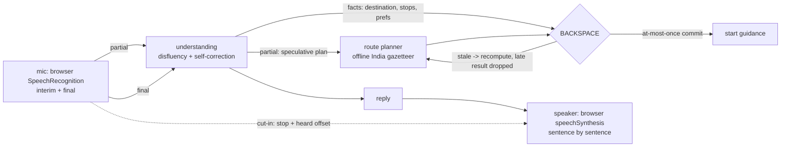

# RouteVoice

[](https://github.com/lakshya-jaiswal07/rev-eng-drive/actions/workflows/ci.yml)

**A voice assistant for setting up a car trip that you can talk over, correct mid-sentence, and that never starts navigation twice.**

Built for **ACE Club - Reverse Engineering**, domain **Transportation and Mobility**.

| | |
|---|---|
| Closed-source app studied | **Google Maps**: voice trip setup with the built-in assistant (Google Assistant / Gemini in Maps) |
| Feature recreated | Hands-free trip setup by voice: say a destination, add stops, ask the ETA, start guidance |
| Built from | Scratch. No Google code, APIs or SDKs; Maps was studied only from the outside, as a user |
| Runs | No API keys, in Chrome or Edge. The server works offline; the map tiles (OpenStreetMap) and Chrome's speech recognition need internet |

**Team MATAR PANEER**, M S Ramaiah Institute of Technology

| Member |
|---|
| Lakshya Jaiswal |
| P Nishant |
| Lucky Preetham Raj B R |
| Joanna Mariya James |

How each evaluation criterion is checked: [docs/VALIDATION.md](docs/VALIDATION.md).
Latest scenario results: [docs/measurements.md](docs/measurements.md).

---

## 1. The feature we studied

In Google Maps you can set up a trip without touching the screen: say where you
want to go, add a stop, ask how long it will take, start navigation. We studied
how that conversation behaves when the person speaking does what real drivers do:
change their mind halfway through a sentence, cut in while the assistant is still
talking, or repeat themselves.

### Reverse-engineering analysis

Observed on the real app (screen recordings in `docs/analysis/`):

| Scenario | What Google Maps did | Evidence |
|---|---|---|
| Correction mid-sentence: *"Take me to Agra... actually no, Jaipur"* | _fill in from recording_ | _clip / screenshot_ |
| Talking over the assistant while it speaks | _fill in_ | |
| After an interruption: does it resume or restart? | _fill in_ | |
| Adding a stop during a trip | _fill in_ | |
| Asking for the ETA while the route is still loading | _fill in_ | |
| Saying "start navigation" twice | _fill in_ | |

How we infer the feature works: _summarise the turn-taking behaviour you
observed (one request -> one reply, cancel or restart on interruption, and so on)._

---

## 2. What we built

A from-scratch rebuild of voice trip setup, plus the behaviour we wanted when
someone interrupts or corrects themselves.

| Capability | How RouteVoice does it |
|---|---|
| **Understands self-corrections** | Rule-based understanding of fillers, false starts and *"actually / no wait / instead / not X, Y"*. *"Agra... actually no, Jaipur"* acts only on Jaipur. |
| **Starts before you finish** | Route planning starts from partial speech, before the sentence ends. If the guess turns out wrong it is thrown away, so it never adds delay. |
| **Discards stale routes** | Destination, origin, stops and preferences are tracked facts, and the route depends on them. Change one while a route is still being planned, and the late result is marked stale and dropped, then recomputed. |
| **Never starts guidance twice** | Starting navigation is an at-most-once commit, so asking twice starts it once. |
| **Stops when you cut in, resumes where you left off** | Talking over it stops its voice at once (its own echo is ignored). The browser reports how many characters you actually heard, and "go on" continues from exactly there instead of restarting. |
| **Never silent, never premature** | Every request gets a spoken acknowledgement right away ("Checking the route to Jaipur..."), never a premature "done". You can ask questions while a route is still planning. |
| **Made for India** | Every Indian city and town of 1,000+ people (GeoNames), with old and alternate names (Bombay, Poona, Bangalore, Cochin) and near-miss spellings. Saved places: *"my office is in Noida"*, then *"take me to the office"*. |

The screen shows these as live numbers: **First response** (heard -> spoken
acknowledgement), **Planned early** (route work started before you finished),
**Stops talking** (cut-in -> speech stopped) and **Resumed** (after how many
interruptions). Use them for the before/after comparison.

### Before / after

| Measure | Google Maps (observed) | RouteVoice (measured) |
|---|---|---|
| Correction mid-sentence lands on the right destination | _fill in_ | yes |
| Time from cut-in to speech stopping | _fill in_ | _read "Stops talking"_ |
| After an interruption, "go on" | _fill in_ | resumes from the heard character |
| "Start navigation" twice | _fill in_ | starts once |

---

## 3. How it works



| Part | Where |
|---|---|
| Understanding (fillers, corrections, stops, saved places, questions) | `server/app/drive/understanding.py` |
| Places and routes (gazetteer, distance and time estimates, "via" towns) | `server/app/drive/geo.py`, `server/app/drive/stops.py` |
| Turn runtime (acknowledge, plan in the background, interrupt, resume) | `server/app/drive/runtime.py` |
| BACKSPACE: facts, dependent work, stale detection, at-most-once commit | `server/app/backspace/` |
| Websocket `/ws/drive` and the web server | `server/app/main.py` |
| UI: mic, speaker, barge-in, trip card, map | `web/src/drive/` |

Stack: Python 3.11+, FastAPI, asyncio · React, Vite, Tailwind, Leaflet ·
speech in and out through the browser's own engines (Web Speech API).

---

## 4. Run it

No keys and nothing to pay for. You need Python 3.11+ and Node 20+.

```bash
make setup   # backend venv + frontend packages
make api     # backend on :8000
make web     # frontend on :5174 (second terminal)
```

<details>
<summary>Without make (Windows PowerShell)</summary>

```powershell
cd server
python -m venv .venv
.venv\Scripts\pip install -r requirements-dev.txt
.venv\Scripts\python -m uvicorn app.main:app --port 8000
```

```powershell
cd web
npm install
npm run dev
```
</details>

Open <http://localhost:5174> in **Chrome or Edge**, tap the mic and allow it
once. Then try:

- *"Take me to, um, Agra... actually no, Jaipur"*
- talk over the reply, then say *"go on"*
- *"Stop for fuel and, uh, a quick coffee on the way"*
- *"How long will it take?"*

The **Try it** buttons replay scripted, disfluent requests through the same path
as the microphone: change of mind mid-sentence, switching while it is still
planning, adding stops, cutting in then "go on", asking twice and starting once,
asking while it plans.

**Docker** (one port, frontend served by the backend):

```bash
docker build -t routevoice .
docker run --rm -p 8000:8000 routevoice
```

Open <http://localhost:8000>.

**Settings** (environment variables):

| Variable | Default | Meaning |
|---|---|---|
| `DRIVE_START_CITY` | Delhi | where the car is (or say *"I'm in Pune"*) |
| `DRIVE_ROUTE_LATENCY_MS` | 1200 | simulated routing-service delay, so the background planning is visible |
| `DRIVE_TOKEN_DELAY_MS` | 70 | pace of the streamed reply |
| `LLM_API_KEY`, `LLM_BASE_URL`, `LLM_MODEL` | unset | optional: an OpenAI-compatible model (e.g. Groq) for questions that are not about driving. Without one the assistant says *"I'm your driving assistant"*. |

**Tests:**

```bash
make test      # 443 tests: gazetteer, understanding, runtime guarantees, the /ws/drive socket, BACKSPACE
make measure   # the evaluation scenarios end to end, 5 runs each -> docs/measurements.md
```

Both run on every push (GitHub Actions). What each test proves, criterion by
criterion: [docs/VALIDATION.md](docs/VALIDATION.md).

---

## 5. Honest limits

- Places are city and town level, not street addresses.
- Distances and times are estimated from coordinates, not from live traffic or a road network.
- Stops are "fuel near <town>", not named businesses.
- The routing service's delay is simulated (`DRIVE_ROUTE_LATENCY_MS`) so the asynchronous behaviour is visible.
- No turn-by-turn guidance: this rebuilds the voice trip-setup conversation, not navigation itself.
- Chrome's speech recognition runs in Google's cloud (free, no key). Use headphones so it doesn't hear its own voice.
- Understanding is rule-based: it is predictable and offline, but it can miss phrasings it hasn't seen.

---

## Credits

- Place data: [GeoNames](https://www.geonames.org), CC BY 4.0 (`server/app/drive/data/`).
- Map tiles in the UI: OpenStreetMap contributors, via Leaflet.
- License: MIT (see `LICENSE`).
